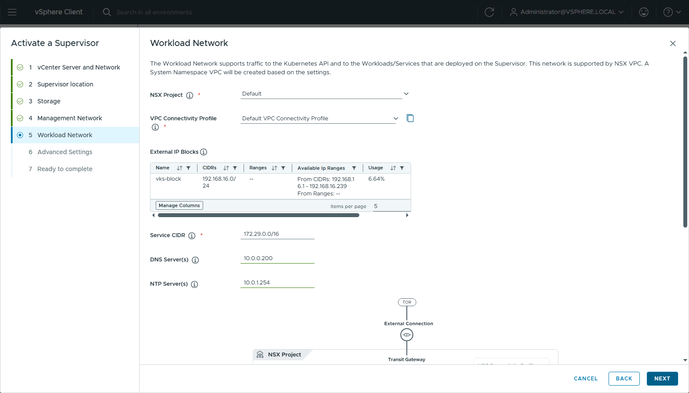
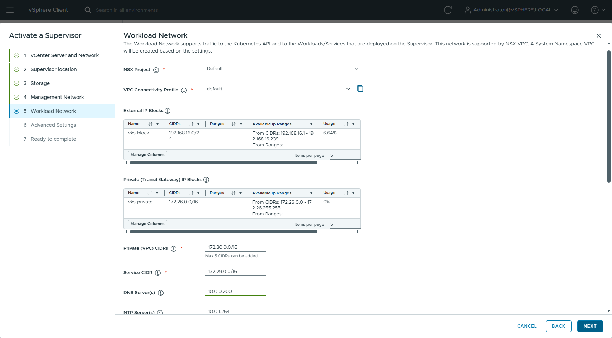
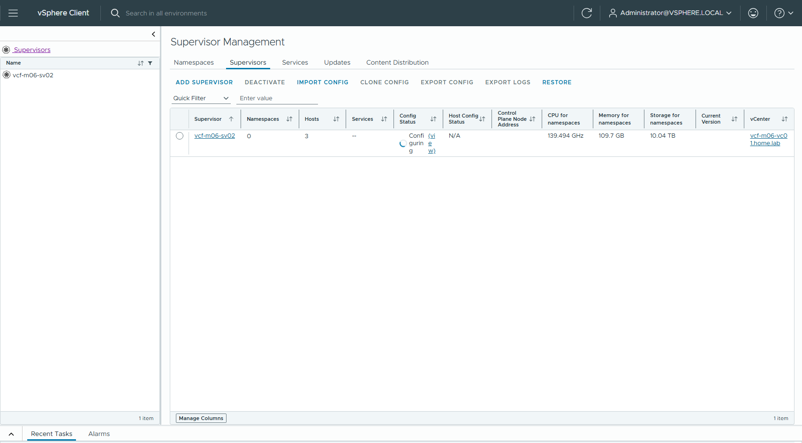

## 1. 目的與結論

客戶規劃的 VKS 容器虛擬網段為：**Service CIDR 100.64.0.0/13 四個 cluster 共用**、**Pod CIDR 100.96.0.0/16 每個 cluster 配一個 /18**（每節點 /24，上限 64 節點）。本文件在 VCF 9.1.1 lab 以同一份叢集定義，分別在 **VLAN-backed VPC** 與 **overlay VPC（FULL_STACK_VPC）** 兩種 Supervisor 網路模式實際建立 VKS 叢集並驗證功能，回答「照這個規劃走 VLAN VPC 或 overlay VPC 會不會有問題」。

**結論**

| 項目 | 結果 |
|---|---|
| 兩種 VPC 模式都能依此規劃建立叢集並正常運作 | ✅ 是。webhook 驗證通過，ClusterIP、DNS、跨節點 pod、air-gap registry 出口、LoadBalancer VIP 全部通過 |
| 100.64.0.0/13 與 NSX 內部網段重疊 | ⚠ 是。NSX Transit Gateway transit 網段為 100.64.0.0/21，每個 VPC 內建 `_services` 子網為 100.64.32.0/24，都落在客戶 Service 段內 |
| 重疊是否造成功能故障 | ❌ 否。LB 流量是「進來 DNAT、回去靠 conntrack 反向 NAT」的有狀態 NAT 流程，不是直接路由；Antrea 的 Service CIDR 只會攔 pod **主動發起**往 100.64.x 的連線，而叢集內沒有任何元件需要主動連 100.64.32.x |
| 建議 | 功能上可用，但建議把 Service 段搬離 100.64.0.0/21 與 100.64.32.0/24（例如 100.72.0.0/13），避免 troubleshooting 混淆與日後擴充風險；Pod 段 100.96.0.0/16 無任何衝突 |

> /13 的 Service 範圍在 kube-apiserver 的 IPv4 上限（/12）以內，Kubernetes 本身不會拒絕。

## 2. 測試環境

| 項目 | 值 |
|---|---|
| VCF / vCenter / NSX | 9.1.1（nested lab，m06 管理網域，3 台 ESX） |
| Supervisor | VCF Networking with VPC；VLAN-backed 版 `vcf-m06-sv01`、overlay 版 `vcf-m06-sv02`，API VIP 皆 192.168.16.3 |
| NSX | Distributed Transit Gateway（無 Edge）+ VNA `vks-vna`；外部 IP block `vks-block` 192.168.16.0/24（VLAN 6） |
| overlay 額外設定 | 主機 TEP（VLAN 9，192.168.19.100–102）、private TGW IP block `vks-private` 172.26.0.0/16、Supervisor Private (VPC) CIDR 172.30.0.0/16 |
| VKS | ClusterClass builtin-generic-v3.7.0，Kubernetes v1.36.2+vmware.2，CP ×1 + worker ×1，best-effort-small |
| 叢集網段（與客戶規劃相同） | `pods.cidrBlocks: 100.96.0.0/18`、`services.cidrBlocks: 100.64.0.0/13` |
| Registry | 內部 Harbor `harbor01.home.lab`（10.0.0.86），VKS 節點無網際網路 |

叢集定義（兩次測試只差名稱與 namespace）：

```
apiVersion: cluster.x-k8s.io/v1beta2
kind: Cluster
metadata:
  name: vks-cidr-vlan            # overlay 版為 vks-cidr-overlay
  namespace: vks-lab             # overlay 版為 vks-ov
spec:
  clusterNetwork:
    pods:
      cidrBlocks: ["100.96.0.0/18"]
    services:
      cidrBlocks: ["100.64.0.0/13"]
    serviceDomain: cluster.local
  topology:
    classRef: {name: builtin-generic-v3.7.0, namespace: vmware-system-vks-public}
    version: v1.36.2---vmware.2-vkr.3
    variables:
      - {name: vmClass, value: best-effort-small}
      - {name: storageClass, value: vks-ftt0}
    controlPlane: {replicas: 1}
    workers:
      machineDeployments:
        - {class: node-pool, name: np-1, replicas: 1}
```

## 3. NSX 實際使用的 100.64 網段（事實）

在 lab 的 NSX 9.1.1 直接查詢，兩種模式都存在：

| NSX 物件 | 網段 | 說明 |
|---|---|---|
| Transit Gateway `default` 的 `transit_subnets` | 100.64.0.0/21 | TGW 與 VPC 之間的內部 transit link |
| 每個 VPC 的 `_services` 子網（Private） | 100.64.32.0/24 | VPC 內建服務子網；overlay 模式下 VNA 的 LB 以此段位址當來源打節點 |

```
$ GET /policy/api/v1/orgs/default/projects/default/transit-gateways/default
  "transit_subnets": ["100.64.0.0/21"]

$ GET /policy/api/v1/orgs/default/projects/default/vpcs/vks-ov_r409x/subnets
  _services                              Private  ['100.64.32.0/24']  CONNECTED
  vks-cidr-overlay-hfchj-346aea4a_r409x  Private  ['172.30.0.0/27']   CONNECTED
```

## 4. 測試 1：VLAN-backed VPC

### 4.1 建立結果

webhook server-side dry-run 通過，18:57 apply，19:04 Available（7 分鐘）。節點直接拿 VLAN 6 的位址（VPC Public subnet 192.168.16.48/28），預設閘道為 VPC subnet 的分散式路由器 192.168.16.49。

```
$ kubectl get nodes -o custom-columns=NAME,PODCIDR,IP
vks-cidr-vlan-d2q4w-xhvj7              100.96.0.0/24   192.168.16.53
vks-cidr-vlan-np-1-mmblj-l7zzc-995zp   100.96.1.0/24   192.168.16.54

$ kubectl get svc -A
default      kubernetes       ClusterIP      100.64.0.1
kube-system  kube-dns         ClusterIP      100.64.0.10
kube-system  antrea           ClusterIP      100.65.97.33
tkg-system   packaging-api    ClusterIP      100.71.85.137

$ antrea-agent.conf
trafficEncapMode: encap
noSNAT: false
serviceCIDR: 100.64.0.0/13
```



### 4.2 功能驗證

| 檢查 | 結果 |
|---|---|
| pod → ClusterIP（名稱與 IP） | ✅ nginx 回應 |
| DNS（kubernetes.default.svc.cluster.local → 100.64.0.1、harbor01.home.lab → 10.0.0.86） | ✅ |
| 跨節點 pod → pod（worker 上的 pod 連 CP 上的 coredns :9153，Geneve 封裝走 VLAN） | ✅ |
| pod 出口到 Harbor（https，期望 401） | ✅ HTTP/1.1 401 |
| LoadBalancer VIP 192.168.16.35 從 VPC 外部 curl ×3 | ✅ 200 |
| 節點與 pod 連 100.64.1.1（TGW transit）/ 100.64.32.1（_services） | 皆不通（本來就不需要，pod 側被 Service CIDR 吃掉，節點側無回應） |

LB（VNA）打 NodePort 的來源是 VNA 在 VLAN 6 上的位址 192.168.16.7，**不在** 100.64 段：

```
$ sudo tcpdump -nni eth0 "tcp port 31462 and tcp[tcpflags] & tcp-syn != 0"   # worker 節點
11:04:09 IP 192.168.16.7.4450 > 192.168.16.54.31462: Flags [SEW] ...
11:04:09 IP 192.168.16.54.31462 > 192.168.16.7.4450: Flags [S.] ...

$ sudo conntrack -L | grep 31462
tcp 6 TIME_WAIT src=192.168.16.7 dst=192.168.16.54 sport=4447 dport=31462 src=100.96.1.3 dst=100.96.1.1 sport=8080 ...
```

## 5. 測試 2：overlay VPC（FULL_STACK_VPC）

### 5.1 環境切換

lab 原本是 VLAN-backed Supervisor，依下列步驟切成 overlay（皆為 NSX / vCenter API，不需重建 NSX 或 VNA）：

1. 三台 ESX 加 TEP：IP pool（VLAN 9）+ uplink profile（transport VLAN 9）+ 更新 host transport node profile。
2. Transit Gateway 的 span 從 SDDC Manager 建立的 `sddc-…` span（network_stack = VLAN_BACKED_VPC）改成 NSX default span → TGW 立即變成 FULL_STACK_VPC。
3. VNA cluster `ha_over_management_interface` 改為 false。
4. VPC Connectivity Profile 加 private TGW IP block，並啟用 `service_gateway.nat_config.enable_default_snat`（精靈會提示「Auto SNAT must be enabled」）。
5. 停用舊 Supervisor，重新以精靈啟用；FULL_STACK 時 Workload Network 頁多出「Private (Transit Gateway) IP Blocks」與「Private (VPC) CIDRs」。





Supervisor 25 分鐘 RUNNING；控制平面 VM 第二張網卡落在 kube-system VPC 的 overlay 私有子網 172.30.0.0/29，主機間 Geneve tunnel 全部 UP。

### 5.2 建立結果

同一份叢集定義 20:50 apply，20:57 Available（6.5 分鐘）。節點在 VPC Private subnet 172.30.0.0/27（overlay），出口經 VPC SNAT 成 192.168.16.7；LoadBalancer VIP 由外部 block 配發。

```
$ kubectl get nodes -o custom-columns=NAME,PODCIDR,IP
vks-cidr-overlay-jwnls-pxnpb              100.96.3.0/24   172.30.0.4
vks-cidr-overlay-np-1-9bq4l-9dj6f-2tks5   100.96.2.0/24   172.30.0.5

$ kubectl get svc -A
default      kubernetes       ClusterIP      100.64.0.1
kube-system  kube-dns         ClusterIP      100.64.0.10
demo         nginx-lb         LoadBalancer   100.71.219.107   192.168.16.9

$ NSX VPC vks-ov NAT（DEFAULT）
SNAT 172.30.0.0/16 -> 192.168.16.7
```

### 5.3 功能驗證

| 檢查 | 結果 |
|---|---|
| pod → ClusterIP | ✅ |
| DNS（kubernetes.default.svc.cluster.local → 100.64.0.1） | ✅ |
| 跨節點 pod → pod（worker → CP 上的 coredns :9153，Geneve 走 TEP tunnel） | ✅ |
| pod 出口到 Harbor（經 VPC SNAT） | ✅ HTTP/1.1 401 |
| LoadBalancer VIP 192.168.16.9 從外部 curl ×3 | ✅ 200 |
| `externalTrafficPolicy: Local`（pod 直接看到 LB 來源 IP） | ✅ 200 ×3，nginx access log 顯示 client = 100.64.32.3 |
| guest cluster 內是否有 endpoint 指向 100.64.32.x | 無；`supervisor` service 的 endpoint 為外部 VIP 192.168.16.3 |

**與 VLAN-backed 的關鍵差異**：overlay 模式下 VNA LB 打 NodePort 的來源是 VPC `_services` 子網的 100.64.32.3，落在客戶 Service 段內。實測即使 `externalTrafficPolicy: Local` 讓 pod 直接看到這個 client IP，回程仍正常。原因是這條流量是 **NAT 進出、不是直接路由**：封包進來時節點對 NodePort 做 DNAT 建立 conntrack，pod 的回包命中同一筆 conntrack 被反向 NAT 後直接從節點 eth0 送回 VNA，不會走到 Antrea 以 Service CIDR 判斷「目的地是不是 Service」的那段邏輯。真正會被攔的只有 pod **自己主動發起**往 100.64.x 的連線，而叢集內沒有這種需求。

```
$ grep 30305 /proc/net/nf_conntrack      # worker 節點
tcp 6 TIME_WAIT src=100.64.32.3 dst=172.30.0.5 sport=4098 dport=30305 src=100.96.2.2 dst=100.96.2.1 sport=8080 ...

$ nginx access log（externalTrafficPolicy=Local）
3 100.64.32.3
```

## 6. 兩種模式比較

| 項目 | VLAN-backed VPC | overlay VPC（FULL_STACK） |
|---|---|---|
| 主機需求 | 不需要 TEP，MTU 1500 可 | 需要 TEP 與 ≥1600 MTU |
| 節點 IP 來源 | VLAN 上的 External IP block（Public subnet） | VPC Private CIDR（overlay subnet） |
| Pod 出口 | 節點 IP（無 NAT） | VPC SNAT 成 External IP |
| LB VIP 來源 | External IP block | External IP block |
| LB 打節點的來源 IP | VNA 的 VLAN IP（192.168.16.7） | VPC `_services` 子網（100.64.32.x） |
| 客戶 Service 段 100.64.0.0/13 | 可用 | 可用（與 LB 來源重疊但實測無影響） |
| 客戶 Pod 段 100.96.0.0/18 | 可用 | 可用 |
| 防火牆放行來源 | 節點 VLAN 子網 | External IP block（SNAT 位址） |

## 7. 給客戶的建議

1. **Service CIDR 建議避開 NSX 保留段**：至少避開 100.64.0.0/21（TGW transit）與 100.64.32.0/24（VPC _services）。最簡單是改用 100.72.0.0/13，或整段移到行內未使用的非 CGNAT 範圍。叢集建立後 CIDR 不可更改，請在簽核前決定。
2. **Pod CIDR 100.96.0.0/16 / 每 cluster /18 維持即可**：兩種模式都是 Antrea encap，Pod IP 不對外路由，也不消耗 VPC 的 IP block，投影片待確認第 2 點不需要再問客戶。
3. **投影片「Egress 經 VPC SNAT 至 External IP」只對 overlay 成立**：VLAN-backed 時 pod 出口是節點自己的 VLAN IP，防火牆要放節點子網。
4. **節點網段容量另外算**：overlay 要把 Private (VPC) CIDR 與 private TGW block 開夠；VLAN-backed 要 VLAN 本身夠大。4 個 cluster、stg/dev 各 61 worker 的規模要先算進去。

## 8. 附錄：證據檔案

| 檔案 | 內容 |
|---|---|
| `E:\9.1\m06\cidr-test\vks-cidr-vlan.yaml`、`vks-cidr-overlay-nonet.yaml` | 兩次測試的叢集定義 |
| `vlan-00-cluster-evidence.txt`、`vlan-01-lb-source-dns.txt` | VLAN-backed：nodes / svc / antrea / tcpdump / conntrack / DNS |
| `overlay-01-cluster-evidence.txt` ～ `overlay-05-nsx-evidence.txt` | overlay：nodes / svc / 功能驗證 / endpoint / externalTrafficPolicy Local / NSX 子網與 NAT |
| `overlay-00-blocker-evidence.txt` | VLAN-backed Supervisor 對 Private subnet 的 webhook 拒絕訊息 |
| `E:\9.1\doc-shots\m06-overlay\` | overlay Supervisor 啟用精靈逐頁截圖 |
